# 🎓 Campus Connect – Campus Event Management System

A JavaFX-based desktop application that simplifies campus event management through centralized event creation, student registration, attendance tracking and participation certificate generation.

<p align="center">
  <b>Java · JavaFX · JDBC · MySQL · Apache PDFBox</b>
</p>

---

## 📌 Overview

Campus Connect is designed to make campus event management more organized and efficient.

The application provides two role-based interfaces:

- **Admin:** Manages events, students, registrations and attendance.
- **Student:** Explores events, registers for them, manages registrations and downloads eligible participation certificates.

It follows a layered architecture using JavaFX for the graphical interface, manager classes for business logic, DAO classes for database operations and MySQL for persistent storage.

## ✨ Features

### 👨‍💼 Admin Module

- Admin authentication and dashboard.
- Dashboard statistics and visual charts.
- Create, edit, delete and cancel campus events.
- Manage event categories, descriptions, dates, timings and venues.
- Configure registration deadlines and event capacity.
- Upload event posters.
- Enable or disable participation certificates.
- Add, edit, delete and search student records.
- View and manage event registrations.
- Mark student attendance as Present or Absent.
- Sort registrations by event date.

### 🎓 Student Module

- Student authentication and personalized dashboard.
- Browse available campus events.
- Search and filter events by category and status.
- View event details, schedules, venues and available seats.
- Register for events.
- View personal registrations.
- Cancel registrations.
- Sort registrations by event date.
- View student profile.
- Change password.
- Download eligible participation certificates.

### 🔐 Additional Functionality

- Role-based authentication.
- Password hashing using PBKDF2WithHmacSHA256.
- Prevention of duplicate registrations.
- Event capacity validation.
- Transaction-based registration handling.
- PDF certificate generation using Apache PDFBox.

---

## 🖥️ Application Screenshots

### 1. Login

The application provides a login interface for administrators and students.

<p align="center">
  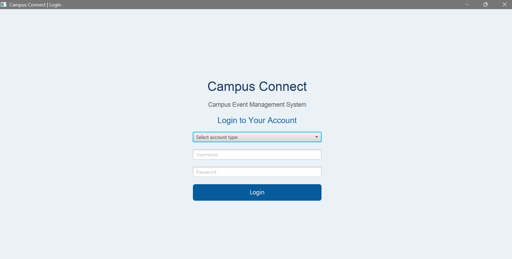
</p>

### 2. Admin Dashboard

The admin dashboard provides an overview of campus event activities through statistics and visualizations.

<p align="center">
  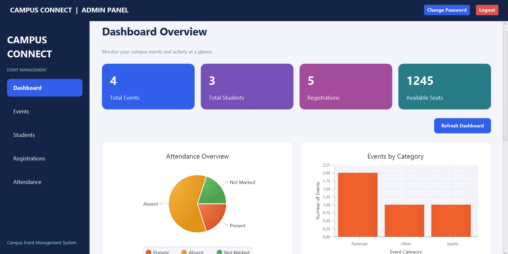
</p>

<p align="center">
  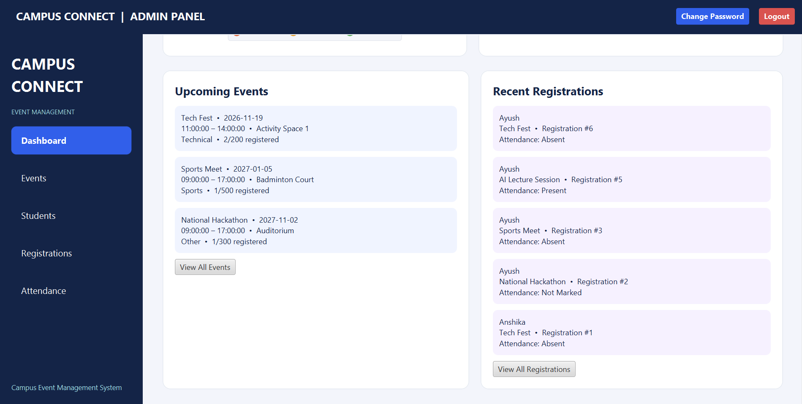
</p>

### 3. Event Management

Administrators can create and manage campus events, configure schedules, set capacities and manage certificate availability.

<p align="center">
  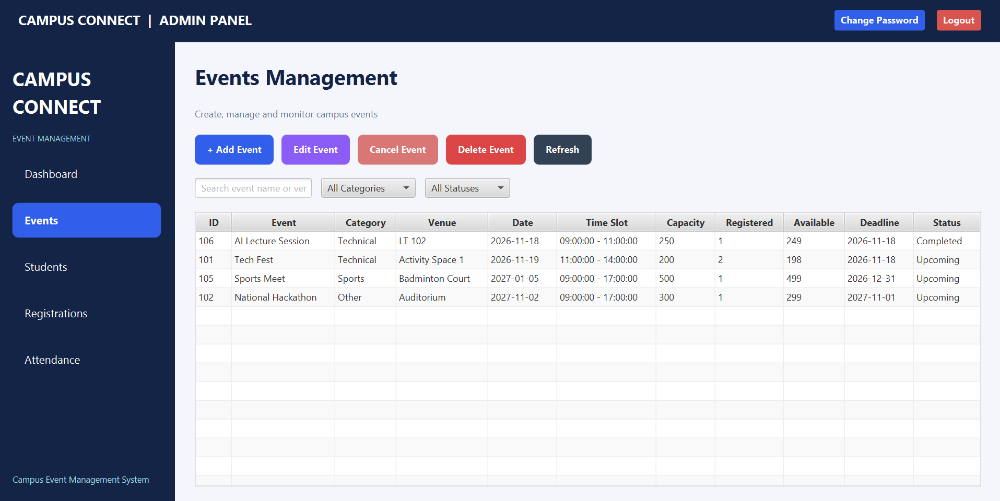
</p>

### 4. Student Management

Administrators can maintain student records and manage student information.

<p align="center">
  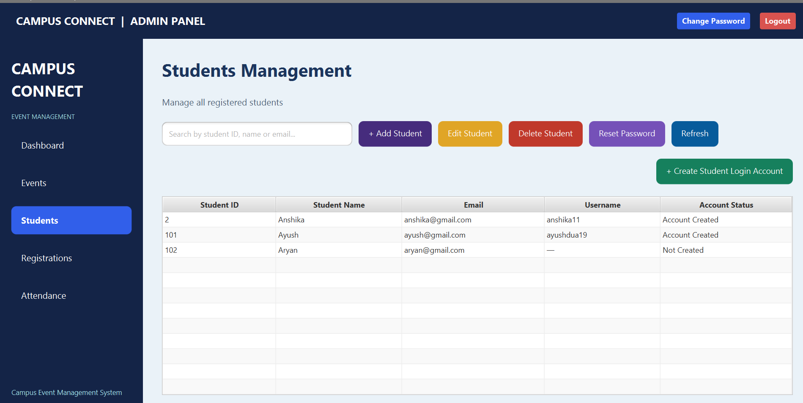
</p>

### 5. Registration and Attendance Management

Administrators can view registrations, manage cancellations and update student attendance.

<p align="center">
  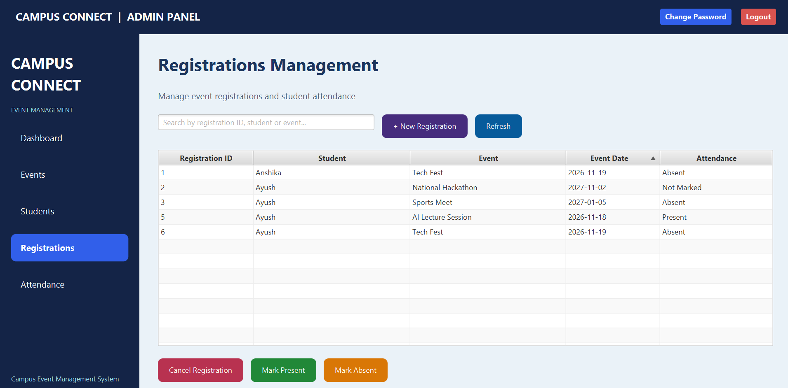
</p>

<p align="center">
  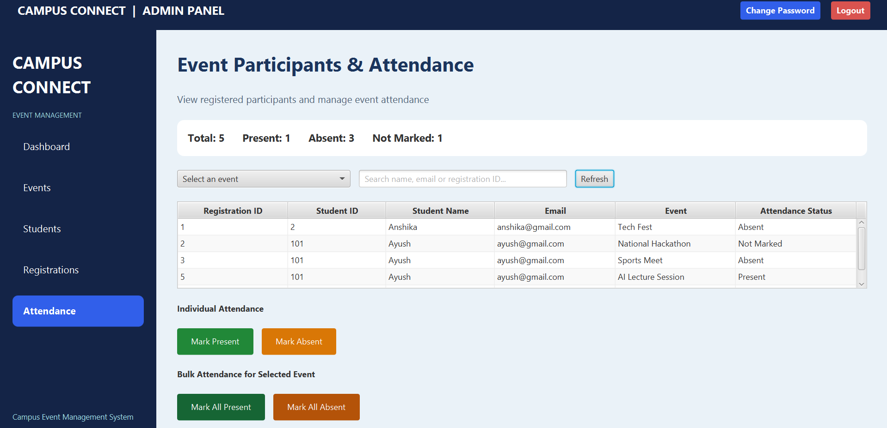
</p>

### 6. Student Dashboard – Browse Events

Students can explore available events and use search and filtering options.

<p align="center">
  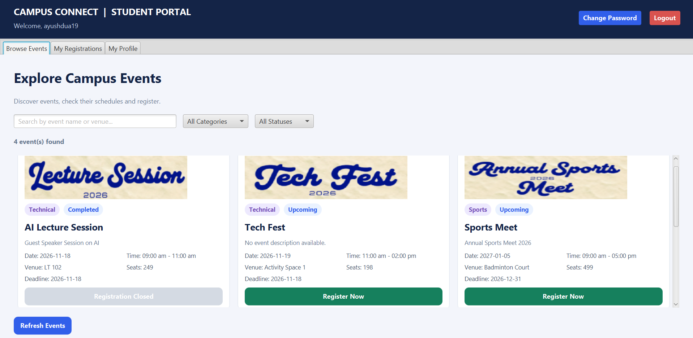
</p>

### 7. Event Registration

Students can register for events directly through their dashboard.

<p align="center">
  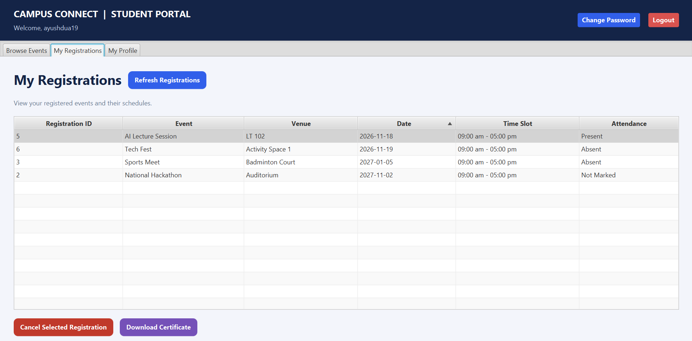
</p>

### 8. Student Profile

Students can view their personal profile information.

<p align="center">
  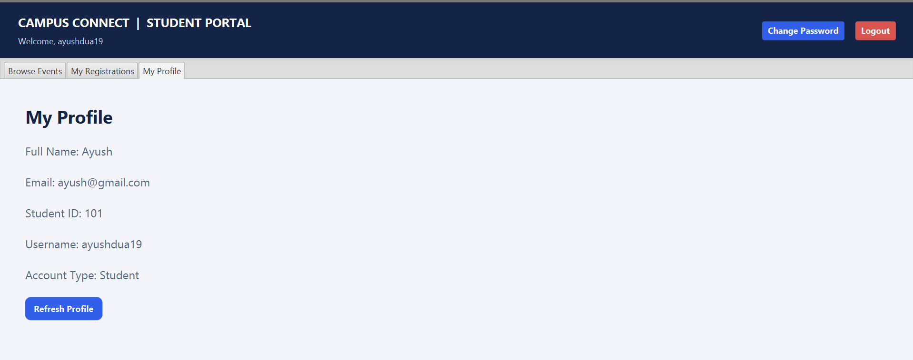
</p>

---

## 🏗️ System Architecture

The project follows a layered architecture to separate the user interface, business logic and database operations.

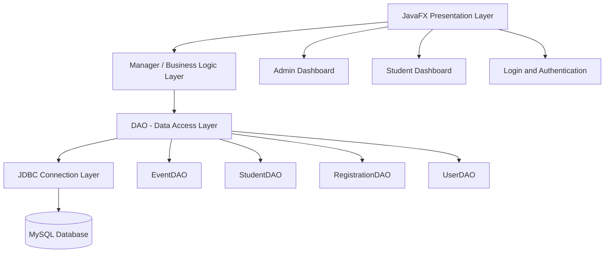

### Architecture Components

| Layer    | Responsibility                                   |
| -------- | ------------------------------------------------ |
| GUI      | JavaFX screens, dashboards and user interactions |
| Manager  | Business logic, validation and application rules |
| DAO      | SQL queries and database operations              |
| Database | JDBC connectivity and MySQL storage              |

## 🗄️ Database Design

The application uses four main database tables:

| Table           | Description                                                     |
| --------------- | --------------------------------------------------------------- |
| `users`         | Login credentials, roles and authentication information         |
| `students`      | Student details                                                 |
| `events`        | Event information, schedules, capacity and certificate settings |
| `registrations` | Student-event registrations and attendance records              |

### Entity Relationship Diagram

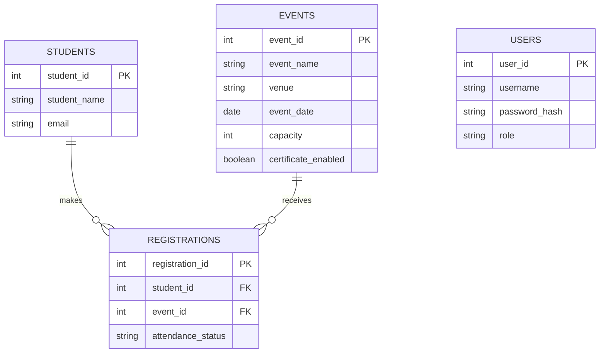

The `registrations` table connects students and events, allowing a student to register for multiple events and an event to receive registrations from multiple students.

Primary keys and foreign keys maintain relationships between records. A unique constraint prevents duplicate registrations for the same student-event combination.

## 🔄 Registration Workflow

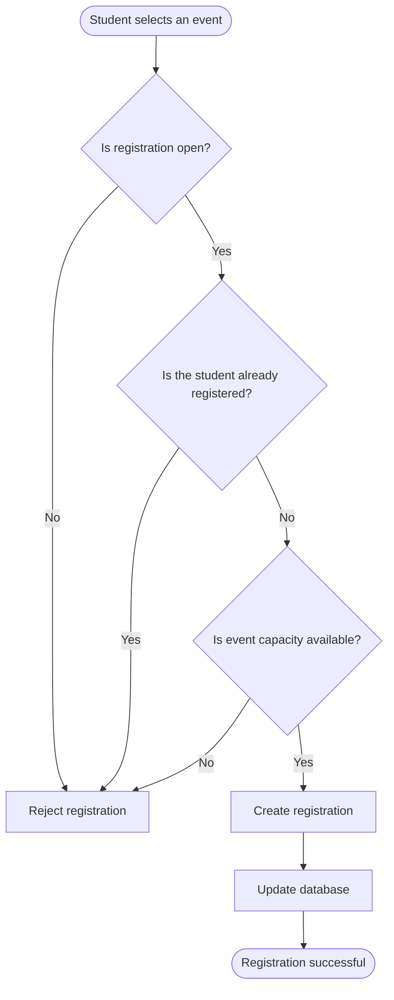

The registration process validates event availability, prevents duplicate registrations and checks capacity before inserting a new record.

Database transactions and row locking using `SELECT ... FOR UPDATE` help maintain capacity consistency when multiple registrations occur concurrently.

## 🏅 Certificate Generation Workflow

Campus Connect supports dynamically generated Certificates of Participation.

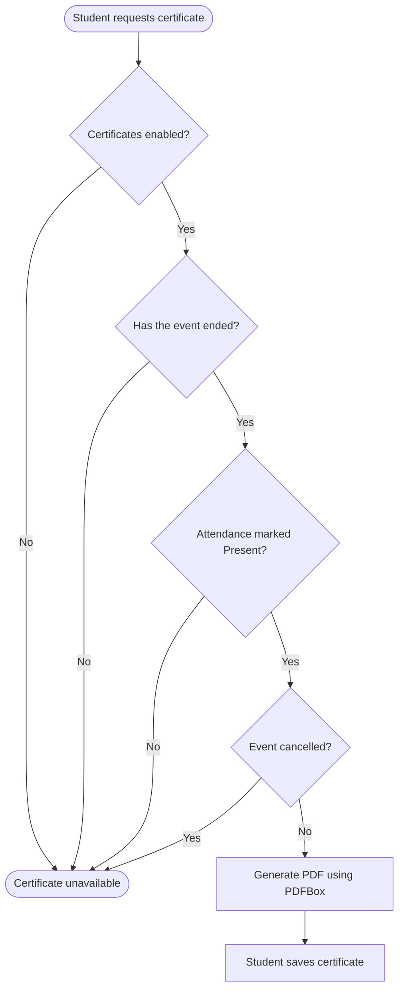

Certificates are available only when the event has ended, certificates are enabled, the student is registered, attendance is marked Present and the event has not been cancelled.

The certificate includes student details, event information, issue date and a unique registration-based certificate ID.

---

## 🛠️ Technology Stack

| Technology        | Purpose                          |
| ----------------- | -------------------------------- |
| Java              | Core application development     |
| JavaFX            | Desktop graphical user interface |
| JDBC              | Database connectivity            |
| MySQL             | Relational database              |
| Apache PDFBox     | PDF certificate generation       |
| MySQL Connector/J | MySQL JDBC driver                |
| VS Code           | Development environment          |

## 📂 Project Structure

```text
Campus_Event_Management/
│
├── .vscode/
│   ├── launch.json
│   └── settings.json
│
├── docs/
│   ├── posters/
│   └── screenshots/
│       ├── login/
│       ├── admin-dashboard/
│       └── student-dashboard/
│
├── lib/
│   ├── mysql-connector-j-26.7.0.jar
│   └── pdfbox-app-2.0.37.jar
│
├── src/
│   └── main/
│       └── java/
│           ├── dao/
│           ├── database/
│           ├── gui/
│           ├── manager/
│           ├── model/
│           └── utils/
│
├── README.md
└── .gitignore
```

## ⚙️ Installation and Setup

### Prerequisites

- JDK 22
- JavaFX SDK 21
- MySQL Server 8.0 or compatible version
- Visual Studio Code
- Java Extension Pack

### 1. Clone the Repository

```bash
git clone YOUR_GITHUB_REPOSITORY_URL
cd Campus_Event_Management
```

Replace the placeholder with the URL of this repository.

### 2. Create the Database

Open MySQL and execute:

```sql
CREATE DATABASE campus_event_mngt;
```

The application requires the database tables used by the project. Run the database setup scripts or use the provided database setup functionality to initialize the schema.

### 3. Configure Database Connection

Update the database connection settings in:

```text
src/main/java/database/DBConnection.java
```

Configure your local MySQL URL, username and password.

**Important:** Do not commit personal database passwords or credentials to GitHub.

### 4. Configure JavaFX

Configure the JavaFX SDK library path in VS Code and ensure the required JavaFX modules are available.

Example VM arguments:

```text
--module-path "PATH_TO_JAVAFX_LIB" --add-modules javafx.controls,javafx.fxml
```

Replace `PATH_TO_JAVAFX_LIB` with your JavaFX SDK `lib` directory.

### 5. Configure Dependencies

Ensure the MySQL Connector/J and Apache PDFBox libraries are available and referenced by the project.

### 6. Run the Application

Run the main class:

```text
main.java.gui.CampusEventApp
```

---

## 🔒 Security and Data Integrity

- Passwords are hashed using PBKDF2WithHmacSHA256.
- Random salts are used during password hashing.
- Role-based access separates administrative and student functionality.
- Prepared statements are used for parameterized SQL operations.
- Unique constraints prevent duplicate student-event registrations.
- Transactions help maintain consistency during registration operations.

## 🚀 Future Enhancements

- Email notifications for event registrations.
- QR-code-based attendance management.
- Online deployment for remote access.
- Certificate verification using QR codes.
- Automated event reminders.
- Advanced analytics and reporting.

## 🎯 Learning Outcomes

This project demonstrates the practical application of:

- Object-Oriented Programming in Java.
- JavaFX GUI development.
- JDBC and MySQL integration.
- Layered software architecture.
- Database relationships and SQL queries.
- Transaction management and concurrency handling.
- Authentication and password security.
- PDF generation using external Java libraries.

## 👩‍💻 Project

**Campus Connect – Campus Event Management System**

A Java desktop application developed to make campus event management simpler, structured and more accessible for administrators and students.
